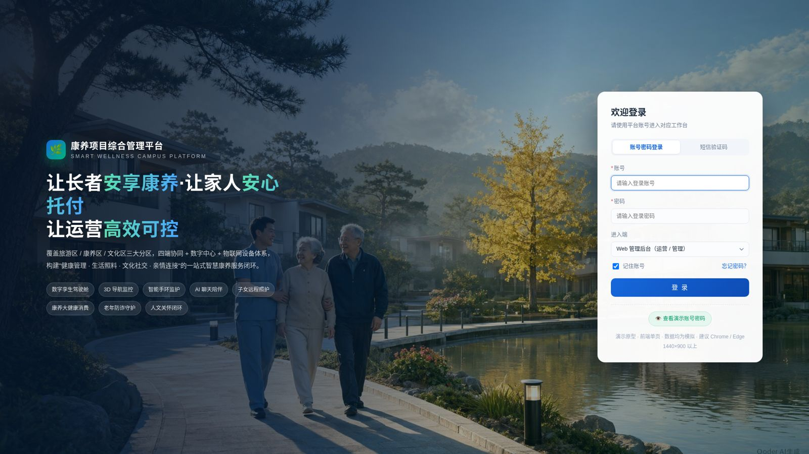
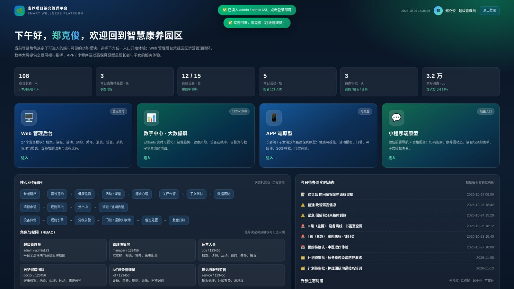
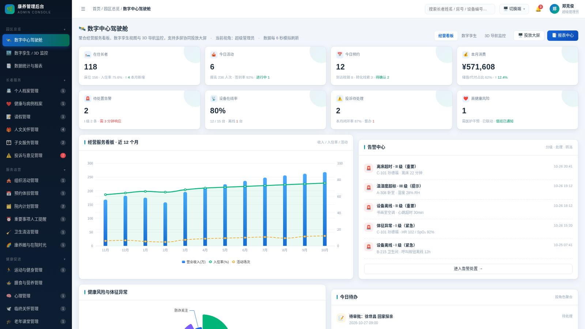
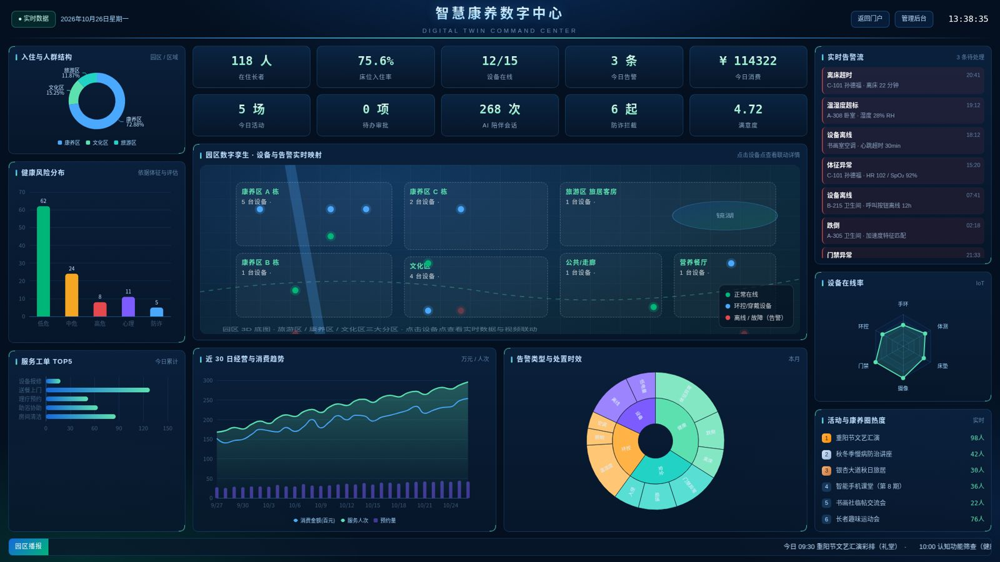
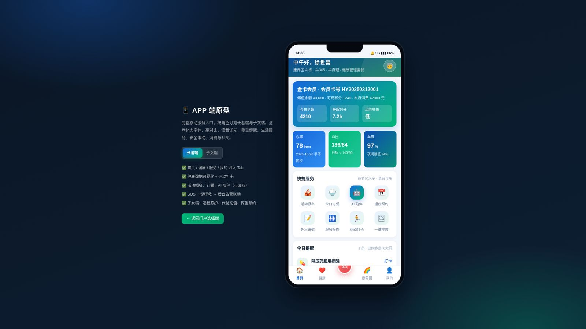
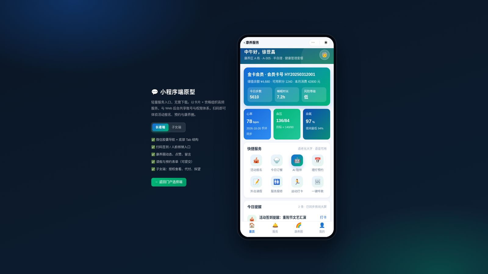

# 康养项目综合管理平台 · 高保真前端原型（单 HTML）

> 依据《康养项目综合管理平台 PRD V1.1》实现的**纯前端**演示原型：一个 `index.html` 文件承载 **Web 管理后台 + 数字中心大数据屏 + APP 端原型 + 小程序端原型** 四端，全部数据为模拟数据，支持完整的增删改查、条件检索、分页、批量删除、CSV 导出与业务流程状态流转。

- 主色：**蓝 `#1668DC` / 黑 `#0A1524` / 绿 `#00B578`**
- 图表：在线 ECharts 5.5.1（jsDelivr，失败自动回退 unpkg，离线时区域占位不报错）
- 数据：浏览器 `localStorage`（键 `ky_proto_v1`），可在「切换端 → 重置演示数据」一键还原初始样例

## 一、运行方式

1. 下载仓库根目录的 `index.html`（约 670 KB，已内联全部 HTML/CSS/JS/数据/登录背景图）；
2. 用 Chrome / Edge 双击打开即可（建议 1440×900 以上；数字大屏按 1920×1080 设计）；
3. 无需 Node、无需后端、无需构建。若要完整体验图表与告警刷新，请保持联网以加载 ECharts CDN。

> 直接双击打开即可，所有交互（新增/编辑/删除/审批/报名/订餐/呼救…）均在本地内存与 localStorage 中真实生效，并会即时反映到其他端。

## 二、演示账号（固定写死）

登录页底部「👁 查看演示账号密码」弹出账号卡片，点击任意卡片自动填入。超级管理员 `admin / admin123`，其余账号密码统一 `123456`。

| 账号 | 密码 | 姓名 | 角色 | 可进入的端 | 说明 |
| --- | --- | --- | --- | --- | --- |
| admin | admin123 | 郑克俊 | 超级管理员 | 门户 / Web / 大屏 / APP / 小程序 | 全部 29 个一级模块 |
| manager | 123456 | 王砚舟 | 管理决策层 | 门户 / Web / 大屏 | 驾驶舱、报表、督办、策略配置 |
| ops | 123456 | 李静怡 | 运营人员 | 门户 / Web / APP / 小程序 | 档案、请假、活动、预约、关怀、投诉 |
| doctor | 123456 | 陈叙白 | 医护健康团队 | 门户 / Web / APP | 健康档案、膳食、心理、运动、临终关怀 |
| iot | 123456 | 赵启明 | IoT 设备管理员 | 门户 / Web / 大屏 | 设备、告警、规则、录像、生物识别 |
| service | 123456 | 孙婉清 | 投诉与服务监督 | 门户 / Web | 投诉受理、升级督办、满意度 |
| social | 123456 | 周与安 | 社工 / 志愿者 | 门户 / Web / 小程序 | 人文关怀、活动、课堂、康养圈 |
| clean | 123456 | 吴桂芳 | 保洁后勤人员 | 门户 / Web | 清洁排期、执行记录、检查验收 |
| elder | 123456 | 徐世昌 | 长者 / 住客 | 门户 / APP / 小程序 | 长者端：健康、活动、订餐、康养圈 |
| child | 123456 | 徐乐 | 子女 / 家属 | 门户 / APP / 小程序 | 子女端：远程照护、代付、探望预约 |

角色决定「可进入的端」与「侧栏可见模块」（RBAC 简化演示），例如 `elder` 登录后仅可见驾驶舱与个人档案，`clean` 仅可见清洁、设备、提醒、计划。

## 三、功能覆盖

**Web 管理后台**：29 个一级入口 / 56 个模块（含 27 个页签子模块），覆盖 PRD 全部功能域——
数字中心驾驶舱（经营看板 / 数字孪生 / 3D 导航监控三视图）、个人档案、健康与病例、请假、组织活动、人文关怀、子女服务、投诉建议、预约体验、院内计划、事项提醒、康养圈与在院时光、运动健身、膳食与营养（菜单/饮食档案/配餐计划/供餐执行）、心理管理、临终关怀、老年课堂、AI 聊天陪伴、防诈守护、消费与会员（会员/套餐/订单核销/储值积分）、物联网设备（台账/实时监测/设备告警/联动规则/固件运维）、监控录像（点位/录像任务/回放导出）、生物识别（特征库/门禁绑定/识别记录）、OCR 识别、系统管理（组织/角色/账号/日志/参数）、外部平台对接（接口/授权映射/调用日志）、统计报表。

**数字中心大屏**：1920×1080 深色三栏布局，6 个 ECharts 图表（人群结构、健康风险、工单 TOP5、设备在线率雷达、30 日经营趋势、告警类型旭日图）+ KPI 带 + 园区孪生映射 + 实时告警流 + 热度榜 + 跑马灯，5 秒刷新图表、9 秒生成新告警。

**APP 端 / 小程序端原型**：392×812 手机壳内高保真还原，左侧可切换「长者端 / 子女端」。
长者端：首页（会员卡、体征卡、快捷宫格、今日提醒、活动报名）、健康（7 日体征趋势图、档案摘要、运动处方打卡、体征记录）、服务/订餐（购物车下单、扫码人脸核销）、康养圈（点赞、发布、留言）、我的（适老化设置）；SOS 一键呼救 3 秒倒计时后联动值班、门禁、大屏与子女端。
子女端：实时动态与告警、数据授权说明、体征与 AI 会话摘要、留言、探望/代预约、外出代申请、待支付订单代付、储值充值、家庭成员协作。

**跨端联动（真实生效）**：长者端报名 → 后台活动「已报名」+1 并生成签到提醒；订餐 → 生成订单（待支付）+ 配餐计划（厨房待确认）；发布动态 → 后台康养圈「待审核」+1；请假申请 → 后台请假「待审批」角标 +1；SOS / 情绪预警 → 写入设备告警并推送大屏与消息中心；子女代付 → 订单转「已支付」、会员累计消费与积分增加、充值即时到账。

## 四、目录结构

```
.
├── index.html                 # 唯一交付物：四端单文件原型（含内联数据与登录背景图）
├── README.md
├── docs/
│   ├── 需求分析.md            # PRD 解读 → 需求清单 / 角色矩阵 / 非功能需求
│   ├── 开发计划.md            # 技术选型、架构分层、里程碑、验收标准、风险
│   └── 实现说明.md            # 实现细节、数据结构、演示脚本、已知限制
└── screenshots/               # 35 张实现截图（登录 / 门户 / 后台 / 大屏 / APP / 小程序）
```

## 五、截图速览

| 登录页（康养实景背景 + 演示账号弹框） | 统一门户（选择端） |
| --- | --- |
|  |  |
| **数字中心驾驶舱** | **大数据展示屏（ECharts）** |
|  |  |
| **APP 端 · 长者** | **小程序端 · 长者** |
|  |  |

完整截图见 [`screenshots/`](screenshots/) 目录。

## 六、说明与限制

- 本期按需求**只实现前端**，无服务端接口；所有「保存」写入内存 + `localStorage`，刷新后仍在，清空浏览器存储即回到初始样例。
- 登录态不做强校验（原型演示用），密码为明文固定值；真实项目需接入统一身份认证、验证码与二次校验。
- 身份证、手机号、健康数据均为**虚构脱敏样例**，不含任何真实个人信息。
- 数字孪生 / 3D 监控以 SVG + 定位图层模拟，未接入真实三维引擎；录像墙、人脸识别、OCR 为界面与流程模拟。
